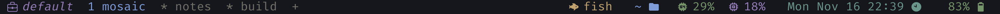
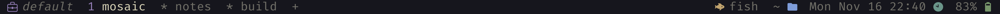

# mosaic.wz [](https://github.com/sravioli/mosaic.wz/releases/latest)

<!-- [](https://github.com/michaelbrusegard/awesome-wezterm) -->

[](https://github.com/sravioli/mosaic.wz/actions/workflows/tests.yaml)
[](https://github.com/sravioli/mosaic.wz/actions/workflows/lint.yaml)
[](https://coveralls.io/github/sravioli/mosaic.wz)
[](../LICENSE)
[](../LICENSE-DOCS)

A status bar engine for [WezTerm](https://wezterm.org/).

You build the bar from modules, and mosaic fits them into the columns the tab
bar leaves free. Modules shrink to shorter variants, drop to icon-only,
truncate, or hide, instead of overflowing. Pick one of eight presets for a
working bar in two lines, or write your own modules: static tables or
functions called on every repaint, with conditions, styles, separators,
fitting strategies and per-module refresh caching, much like heirline.nvim
components.

[Quick start](#quick-start) · [Usage](#usage) · [Configuration](#configuration) · [API reference](#api-reference) · [Integrations](#integrations) · [Troubleshooting](#troubleshooting) · [Development](#development) · [License](#license)

## Quick start

### Requirements

Requires **WezTerm [`20230320-124340-559cb7b0`](https://wezterm.org/config/lua/wezterm.plugin/require.html)
or newer** and a [Nerd Font](https://www.nerdfonts.com/) (or WezTerm's
bundled Nerd Font Symbols fallback) for the presets' and modules' glyphs.

mosaic loads its plugin dependencies itself with `wezterm.plugin.require`;
local API modules on `package.path` take precedence over the remote ones.

| Plugin                                             | Used for                                        | Loaded                  |
| -------------------------------------------------- | ----------------------------------------------- | ----------------------- |
| [warp.wz](https://github.com/sravioli/warp.wz)     | Strings, widths, paths, tables, child processes | Always                  |
| [log.wz](https://github.com/sravioli/log.wz)       | Logging                                         | Always                  |
| [warden.wz](https://github.com/sravioli/warden.wz) | Option validation                               | Always                  |
| [ribbon.wz](https://github.com/sravioli/ribbon.wz) | Building formatted cells                        | Always                  |
| [sigil.wz](https://github.com/sravioli/sigil.wz)   | Icons of the built-in modules and presets       | When a layout names one |

Some built-in modules read the system. Each program runs only while its
module is in a layout, and never from the drawing itself:

| Program                                                                         | Module                  | Platform     | Notes                                                                                             |
| ------------------------------------------------------------------------------- | ----------------------- | ------------ | ------------------------------------------------------------------------------------------------- |
| `/proc` (no program)                                                            | `cpu`, `ram`, `network` | Linux        | Read directly.                                                                                    |
| `df`                                                                            | `disk`                  | Linux, macOS | Every 30 s.                                                                                       |
| `ps`, `vm_stat`, `sysctl`, `netstat`                                            | `cpu`, `ram`, `network` | macOS        | Fast commands only.                                                                               |
| [`playerctl`](https://github.com/altdesktop/playerctl), else systemd's `busctl` | `media`                 | Linux        | Either reads the players' MPRIS interface; with neither, `media` logs a warning and stays hidden. |
| `osascript`                                                                     | `media`                 | macOS        | Ships with macOS.                                                                                 |

`git` and `kube` run no program: they read `.git/HEAD` and the kubeconfig
file. On Windows the system modules and `media` hide themselves.

### Install and run

Put this in `wezterm.lua`:

```lua
local wezterm = require "wezterm"
local mosaic = wezterm.plugin.require "https://github.com/sravioli/mosaic.wz"
local config = wezterm.config_builder()

mosaic.setup { preset = "powerline" }
mosaic.apply_to_config(config)

return config
```

`apply_to_config` registers the `update-status` and `format-tab-title`
handlers, sets `tab_bar_at_bottom` from `position`, and draws the new-tab
button in the preset's style. In an existing config, keep its builder and
return; add the import, setup and `apply_to_config`. Open a window: the
workspace sits on the left, and directory, host, clock and battery on the
right.

## Usage

### Pick a preset

Set `preset` to one of these names. The screenshots show Kanagawa Wave (dark) and
Kanagawa Lotus (light), in Fira Code Nerd Font.

#### `powerline`

Coloured pills on the left, a powerline gradient on the right, slanted numbered tabs.

<picture>
  <source media="(prefers-color-scheme: light)" srcset="assets/presets/light/powerline.png">
  
</picture>

#### `minimal`

Accent-coloured text on the bar background, no separators; plain numbered tabs.

<picture>
  <source media="(prefers-color-scheme: light)" srcset="assets/presets/light/minimal.png">
  
</picture>

#### `bubbles`

Every module and tab is a rounded pill.

<picture>
  <source media="(prefers-color-scheme: light)" srcset="assets/presets/light/bubbles.png">
  
</picture>

#### `slanted`

Every module and tab is a block with slanted edges (`/ … /`); the outermost modules stay flat against the window.

<picture>
  <source media="(prefers-color-scheme: light)" srcset="assets/presets/light/slanted.png">
  
</picture>

#### `slanted-inverted`

`slanted`, leaning the other way (`\ … \`).

<picture>
  <source media="(prefers-color-scheme: light)" srcset="assets/presets/light/slanted-inverted.png">
  
</picture>

#### `blocks`

Flat blocks one column apart, with no separator glyphs.

<picture>
  <source media="(prefers-color-scheme: light)" srcset="assets/presets/light/blocks.png">
  
</picture>

#### `brackets`

Accent-coloured text in dim `[ ]` on the bar background, with ASCII separators.

<picture>
  <source media="(prefers-color-scheme: light)" srcset="assets/presets/light/brackets.png">
  
</picture>

#### `pure`

Dim text with each icon in its accent colour, no backgrounds or separator glyphs, as in the pure prompt.

<picture>
  <source media="(prefers-color-scheme: light)" srcset="assets/presets/light/pure.png">
  
</picture>

Each preset supplies a layout, styles every module and tab, and draws the
new-tab button to match. Presets are built only from the public API, so any
of them can be reproduced, or forked, in your own config.

### Customize without code

Built-in modules and integrations return **content only**: icon, text,
padding, conditions, and optionally an `accent` colour hint. The preset's
decorator gives each of them its look, so anything you add to a layout
matches the preset. Three tables change everything else, with no module or
decorator to write.

`options` changes any module by name, built-in, integration or your own:

```lua
mosaic.setup {
  preset = "powerline",
  options = {
    clock = { format = "%H:%M", variants = {}, icon = false },
    cwd = { git_root = false, icon = "" },
    battery = { cond = true }, -- stay visible while key hints show
    workspace = { text = { style = { attributes = "" } } }, -- not italic
    zoomed = { text = "Z", accent = 2 },
    cpu = { update = 10 }, -- sample every 10 s
    hostname = { enabled = false },
    process = { fmt = string.upper }, -- format the text
    git = { icon = { color = 3 } }, -- colour just the icon
  },
}
```

`style` sets the colours and glyphs every module is decorated with:

```lua
style = {
  colors = { cwd = 4, clock = "#e46876" }, -- per module
  separators = { left = "", right = "" },
  text = "background", -- text on filled modules
  dim = 9, -- muted text and glyphs (brackets, pure)
  gradient = { base = 5, stops = { -0.15, 0, 0.15, 0.25 } }, -- powerline's right side
  raw = { "battery" }, -- plain text in its colour, no separators
  by_mode = { copy_mode = { gradient = { base = 4 } }, leader = { colors = { workspace = 2 } } },
}
```

`tabs.style` sets the tabs and the new-tab button:

```lua
tabs = {
  style = {
    colors = { active = 5, hover = 7, inactive = 9, text = "background" },
    index = "number", -- "icon", false, or fun(tab, ctx): string
    unseen = "*", -- shown in place of the index on unseen output; false to ignore
    separators = { left = "", right = "" }, -- tab edges
    new_tab = "+", -- new-tab button label
  },
}
```

See [colours](#colours) for the values a colour accepts and
[option keys](#option-keys) for every key. A module that sets its own `style`
is left exactly as it is: that is the escape hatch for a fully custom look.
Set `decorate` to replace the preset's decorator for every module, or wrap a
module in code with `mosaic.extend`.

### Write a module

A module is a table, or a function `fun(window, pane, theme, config)` that
returns one. Functions run on every repaint, so return `{ enabled = false }`
to skip a frame.

```lua
mosaic.setup {
  preset = "powerline",
  layout = { right = { { "git", "clock" } } },
  modules = {
    git = function(window, pane, theme)
      local branch = pane:get_user_vars().git_branch
      if not branch then
        return { enabled = false }
      end
      return {
        enabled = true,
        can_hide = true,
        update = function() return branch end, -- reuse the spec while unchanged
        accent = 3, -- let the preset style it; or set `style` yourself
        icon = { enabled = true, value = wezterm.nerdfonts.dev_git_branch, padding = { right = 1 } },
        text = { enabled = true, value = branch, variants = { branch:sub(1, 8) } },
      }
    end,
  },
}
```

See [module fields](#module-fields) for every field. Use `update` for
anything that costs more than a table lookup (sampling, process queries).

### Centre modules

WezTerm's tab bar has a left and a right status but no centre, so mosaic
makes one: `layout.center` modules are drawn where a centred block belongs,
in the space the tabs and the right modules leave.

```lua
mosaic.setup {
  preset = "powerline",
  layout = {
    left = { "workspace" },
    center = { "notice" }, -- messages pop up in the middle
    right = { { "cwd", "clock", "battery" } },
  },
  center = { anchor = "window", overflow = "shift" },
}
```

The right modules keep priority: the centre fits into what they leave, with
the same fitting as any group, and moves out of the way of the tabs and the
right modules (or hides, with `overflow = "hide"`). Decorators see
`ctx.side == "center"`. With the fancy tab bar the position is approximate,
because its proportional font has no column grid.

### Choose the layout per window

`layout` can be a function. It runs on every frame with the window and its
active pane, so the bar can change with the workspace, the domain or the
active key table:

```lua
layout = function(window, pane)
  if pane:get_domain_name():match "^SSH" then
    return { left = { "workspace", "ssh" }, right = { { "hostname", "clock" } } }
  end
  return { left = { "workspace" }, right = { { "cwd", "git", "clock", "battery" } } }
end
```

Sides it leaves out are empty. If it fails, mosaic logs the error once and
draws the preset's layout. Integrations named only by a function layout load
on first use.

### Format tabs

The preset styles the tabs too, and every tab's width goes to the width
budget automatically. Supply only the title text, or replace the whole cell:

```lua
mosaic.setup {
  preset = "powerline",
  tabs = {
    -- Title text only; the preset draws the rest of the cell.
    title = function(tab, max_cells)
      return tab.active_pane.title:sub(1, max_cells)
    end,
    -- Or replace the whole cell: return { bg, fg, text, attributes } segments.
    -- format = function(ctx) ... end,
    -- And the new-tab button: fun({ theme, config, hover }) → segments.
    -- new_tab = function(ctx) ... end,
  },
}
```

`ctx` carries `tab`, `tabs`, `theme`, `config`, `hover`, `max_width`,
`state` (`"active"`, `"hover"` or `"inactive"`), `unseen` (any pane has
unseen output), and `title(max_cells)`, which calls your title hook. Use
`mosaic.width(s)` to measure the decorations, and pass the remaining columns
to `ctx.title`.

To format tabs yourself, set `tabs = false`. Then report the widths, so the
right status still fits:

```lua
wezterm.on("format-tab-title", function(tab, tabs, ...)
  local title = ...
  mosaic.budget.record(tab.tab_index, wezterm.column_width(title))
  mosaic.budget.set_count(#tabs)
  return title
end)
```

Without that, mosaic estimates the tab widths from `tab_max_width`.

### Compose tabs

Build the tab text from components instead of a title hook. The preset still
draws the cell and the index around it:

```lua
tabs = {
  content = {
    active = { "process", "parent", "/", "cwd", "zoomed" },
    inactive = { { "process", icon_only = true }, "title", "output" },
  },
}
```

| Component  | Shows                                                                               | Options                                                             |
| ---------- | ----------------------------------------------------------------------------------- | ------------------------------------------------------------------- |
| `title`    | The tab title, else the pane title, through your `title` hook.                      |                                                                     |
| `process`  | Icon and name of the foreground process.                                            | `icons` (merged over the built-in map), `icon_only`, `icon = false` |
| `cwd`      | The directory's name, or the whole path with `full = true`.                         | `full`, `home`, `aliases`, `max_length`                             |
| `parent`   | Name of the parent directory.                                                       | `max_length`                                                        |
| `zoomed`   | An icon while the pane is zoomed.                                                   | `icon`                                                              |
| `output`   | An icon while a pane has unseen output.                                             | `icon`, `idle` (shown otherwise)                                    |
| `panes`    | The pane count, above one.                                                          | `icon`                                                              |
| `progress` | What the pane's program reports (OSC 9;4): a circle that fills, and the percentage. | `icon = false`, `icon_only`                                         |
| `domain`   | The domain, unless local.                                                           | `icons`, `icon_only`, `show_local`                                  |
| `icon`     | The icon a matching [rule](#tab-rules) sets.                                        | `default`                                                           |

A string is drawn as written and a function `fun(tab, ctx): string` as it
returns. Components get one space between them, strings none, so
`"parent", "/", "cwd"` reads `src/mosaic`. A single list applies to every
tab; hovered tabs use the `inactive` list. When space is short, components
right of the title go first, then the title is cut. Set `tabs.style.index`
to `false` (or `"number0"` to count from zero) to change the preset's index.

### Tab rules

Recolour or re-icon tabs by what runs in them. Rules apply in order; each
match merges its `style` (any `tabs.style` key) over the previous ones:

```lua
tabs = {
  rules = {
    { match = { domain = { pattern = "^SSH" } }, style = { colors = { active = 2, inactive = 2 } }, icon = "" },
    { match = { cwd = { pattern = "^/srv/prod" }, process = "psql" }, style = { colors = { active = "#e46876" } } },
    { match = { user_var = { name = "env", value = "staging" } }, style = { colors = { inactive = 4 } } },
  },
}
```

`match` takes `domain`, `cwd`, `process` (the basename), `title` and
`user_var`. Each value is a string (exact), `{ pattern = "…" }` (Lua
pattern) or `fun(value): boolean`, and every key given must match. A rule
without `match` is rejected, so it can never recolour every tab.

### Tab badges

Make a tab light up while you are elsewhere: on a bell, on unseen output, or
when a script or an agent hook sets a pane user variable:

```lua
tabs = { badges = true } -- bell, plus the working / done / waiting states
```

```sh
# in a hook: mark this pane's tab
printf '\e]1337;SetUserVar=badge=%s\a' "$(printf done | base64)"
```

| Source           | Default badge                 | Cleared                            |
| ---------------- | ----------------------------- | ---------------------------------- |
| `states.working` | robot icon, `6`               | when the variable changes (sticky) |
| `states.waiting` | alert icon, `2`               | when the variable changes (sticky) |
| `states.done`    | check icon, `3`               | when you focus the tab             |
| `bell`           | bell icon, `4`                | when you focus the tab             |
| `output`         | off; `true` for unseen output | when you focus the tab             |

A badge replaces the tab's index with its icon and fills the tab with its
colour. Override any
part:
`badges = { var = "agent", states = { review = { icon = "", color = 5, sticky = true } }, output = true }`.
A var state wins over a bell, and a bell over output. A non-sticky state
comes back when the variable is set again, even to the same value. Put the
`badges` module in a layout to count the tabs that need you.

### Show a message for a while

`mosaic.notify(window, "session saved", { seconds = 3 })` shows a message in
the `notice` slot, which every preset places on the right. Plugins that do
not depend on mosaic emit the event instead:

```lua
wezterm.emit("mosaic-notify", window, pane, "session saved", { icon = "", accent = 3 })
```

Without a window (`nil`, as in the debug overlay's REPL), the message goes
to every window.

## Configuration

### Example

Call setup before `apply_to_config`. Every option is optional:

```lua
mosaic.setup {
  preset = "bubbles",
  position = "top",
  fit = "exhaustive",
  layout = {
    left = { "leader", "workspace", "mode" },
    right = { "hints", { "cwd", "hostname", "clock", "battery" } },
  },
}
```

### Options

| Option                     | Type                                                | Default                                          | Description                                                                                                                                                                  |
| -------------------------- | --------------------------------------------------- | ------------------------------------------------ | ---------------------------------------------------------------------------------------------------------------------------------------------------------------------------- |
| `enabled`                  | `boolean`                                           | `true`                                           | `false` clears the bar.                                                                                                                                                      |
| `position`                 | `"top"\|"bottom"`                                   | `"bottom"`                                       | Sets `tab_bar_at_bottom`.                                                                                                                                                    |
| `preset`                   | `string?`                                           | `nil`                                            | One of the [presets](#pick-a-preset). Supplies the layout, modules, decorator and tabs.                                                                                      |
| `flexible`                 | `boolean`                                           | `true`                                           | Fit modules to the free width.                                                                                                                                               |
| `fit`                      | `"greedy"\|"balanced"\|"exhaustive"`                | `"balanced"`                                     | Fitting strategy for groups; see [fitting](#fitting).                                                                                                                        |
| `layout`                   | `{ left?, center?, right? }\|fun(window, pane)`     | preset's                                         | Module names per side; a nested table is a fitted group. Replaces the preset layout entirely. A function returns the layout for each window on every frame.                  |
| `layout.center`            | `item[]`                                            | `{}`                                             | Modules drawn in the [centre](#centre-modules) of the bar.                                                                                                                   |
| `center.anchor`            | `"window"\|"free"`                                  | `"window"`                                       | Centre on the whole bar, or in the space between the tabs and the right modules.                                                                                             |
| `center.overflow`          | `"shift"\|"hide"`                                   | `"shift"`                                        | When the centred spot would touch the tabs or the right modules: slide into the free space, or hide.                                                                         |
| `center.margin`            | `integer`                                           | `1`                                              | Columns kept clear on both sides of the centre.                                                                                                                              |
| `modules`                  | `table<string, module\|string>`                     | `{}`                                             | Replaces modules by name. A string aliases another name, e.g. `hints = "chord.hints"`.                                                                                       |
| `options`                  | `table<string, table>`                              | `{}`                                             | Changes a module by name; see [option keys](#option-keys). Integrations receive theirs too.                                                                                  |
| `style.colors`             | `table<string, colour>`                             | `{}`                                             | A module's colour.                                                                                                                                                           |
| `style.separators`         | `{ left?, right? }`                                 | preset's                                         | Glyphs drawn before (`left`) and after (`right`) every module.                                                                                                               |
| `style.text`               | `colour`                                            | `"background"`                                   | Text on filled modules (powerline, bubbles, slanted, blocks).                                                                                                                |
| `style.dim`                | `colour`                                            | `9`                                              | Muted text and glyphs (brackets' brackets, pure's text).                                                                                                                     |
| `style.gradient`           | `{ base?, stops? }`                                 | `{ base = 5, stops = { -0.15, 0, 0.15, 0.25 } }` | Powerline's right-side gradient: the base colour and the darken (-) / lighten (+) offset of each stop. Longer groups stretch over the range.                                 |
| `style.raw`                | `string[]`                                          | `{}`                                             | Modules drawn plain: their colour as text on the bar background, one column of padding each side, no separators.                                                             |
| `style.by_mode`            | `table<string, style>`                              | `{}`                                             | Style merged over the rest while a key table (by name) or the leader (`leader`) is active.                                                                                   |
| `style.separators.between` | `string`                                            | `nil`                                            | Glyph between the modules of a group, in `style.dim`.                                                                                                                        |
| `scheme`                   | `string\|table`                                     | `nil`                                            | Take the palette from another colour scheme (a name or a scheme table). The bar keeps the active scheme's background.                                                        |
| `decorate`                 | `fun(spec, ctx): spec`                              | preset's                                         | Replaces the preset's decorator.                                                                                                                                             |
| `tabs`                     | `false\|{ title?, format?, new_tab?, style? }`      | preset's                                         | Tab hooks and look; `false` leaves `format-tab-title` to you.                                                                                                                |
| `tabs.style.colors`        | `table<string, colour>`                             | preset's                                         | `active`, `hover` and `inactive` fill the tab for its state, `text` is the text on filled tabs. brackets and pure also read `dim`, and pure reads `head` (the active index). |
| `tabs.style.index`         | `"number"\|"number0"\|"icon"\|false\|fun(tab, ctx)` | preset's                                         | The tab's index: from one, from zero, a Nerd Font digit, none, or your text.                                                                                                 |
| `tabs.style.unseen`        | `string\|false`                                     | preset's                                         | Replaces the index while a pane has unseen output.                                                                                                                           |
| `tabs.style.separators`    | `{ left?, right? }`                                 | preset's                                         | Tab and new-tab button edges.                                                                                                                                                |
| `tabs.style.new_tab`       | `string`                                            | `"+"`                                            | New-tab button label.                                                                                                                                                        |
| `tabs.style.padding`       | `integer\|{ left?, right? }`                        | `0`                                              | Columns around the tab text.                                                                                                                                                 |
| `tabs.content`             | `item[]\|{ active?, inactive? }`                    | `nil`                                            | Tab text from [components](#compose-tabs).                                                                                                                                   |
| `tabs.rules`               | `rule[]`                                            | `{}`                                             | Per-tab [rules](#tab-rules).                                                                                                                                                 |
| `tabs.badges`              | `true\|table`                                       | `nil`                                            | [Tab badges](#tab-badges).                                                                                                                                                   |

#### Colours

Every colour option takes `1`-`8` for `theme.ansi`, `9`-`16` for
`theme.brights`, `"foreground"` or `"background"` for the scheme's own, a
colour string such as `"#e46876"`, or `fun(theme): colour`. Values follow
the active colour scheme, so they stay right when you switch scheme.

#### Option keys

Every module accepts these keys in `options[name]`. They are merged into the
module's spec each frame, over what the module returns:

| Key                                           | Type                         | Effect                                                                                                               |
| --------------------------------------------- | ---------------------------- | -------------------------------------------------------------------------------------------------------------------- |
| `enabled`                                     | `boolean`                    | `false` hides the module.                                                                                            |
| `cond`                                        | `boolean\|fun(window, pane)` | When it shows; `true` keeps it visible during key hints and modes.                                                   |
| `icon`                                        | `false\|string\|table`       | Hide the icon, replace the glyph, or merge into it (`position`, `padding`, `style`, and `color` for the icon alone). |
| `text`                                        | `false\|string\|table`       | Hide the text, replace it, or merge into it (`value`, `variants`, `trim`, `padding`, `style`).                       |
| `accent`                                      | `colour`                     | The module's colour hint; `style.colors` still wins.                                                                 |
| `padding`, `can_hide`, `priority`, `min_text` |                              | As in [module fields](#module-fields).                                                                               |
| `sep`                                         | `false\|table`               | `false` drops the separators; a table is merged over the preset's (`value`, `style`).                                |
| `style`                                       |                              | Style the module yourself; the preset then leaves it alone.                                                          |
| `update`                                      | `number\|table\|fun\|false`  | Replaces the module's refresh interval or key; `false` re-runs it every frame.                                       |
| `fmt`                                         | `fun(text, window, pane)`    | Formats the text and every variant.                                                                                  |

Some built-ins read keys of their own:

| Module     | Key                                                     | Default                                   | Effect                                                                   |
| ---------- | ------------------------------------------------------- | ----------------------------------------- | ------------------------------------------------------------------------ |
| `clock`    | `format`                                                | `"%a %b %-d %H:%M"`                       | strftime format.                                                         |
| `clock`    | `variants`                                              | `{ "%b %-d %H:%M", "%a %H:%M", "%H:%M" }` | Shorter formats tried when space is tight, longest first.                |
| `cwd`      | `git_root`                                              | `true`                                    | `false` shows the directory itself inside a repository.                  |
| `cwd`      | `home`                                                  | `nil`                                     | Replace the home directory, e.g. `"~"`.                                  |
| `cwd`      | `aliases`                                               | `nil`                                     | `{ { pattern = "^/srv/www", replacement = "www" } }`, applied first.     |
| `cwd`      | `max_length`                                            | `nil`                                     | Cut from the left past this width.                                       |
| `parent`   | `full`, `home`, `aliases`, `max_length`                 |                                           | `full = true` shows the whole parent path.                               |
| `clock`    | `icons`                                                 | hour faces                                | `false`, or `{ ["00"] = glyph, ... }` by 24-hour hour.                   |
| `battery`  | `all`                                                   | `false`                                   | Every battery's charge.                                                  |
| `battery`  | `time`                                                  | `false`                                   | Time to empty or full after the charge.                                  |
| `battery`  | `levels`                                                | `nil`                                     | `{ [15] = 2, [40] = 4 }`: a state colour at or below a charge.           |
| `battery`  | `charging`                                              | `nil`                                     | State colour while charging or full, over `levels`.                      |
| `mode`     | `modes`                                                 | `{}`                                      | `{ copy_mode = { text = "YANK", icon = "", color = 4 } }` per key table. |
| `mode`     | `format`                                                | upper-case name                           | `fun(name): string` for the default text.                                |
| `process`  | `icons`, `icon_only`                                    | built-in map                              | Glyph per process basename (`false` drops one).                          |
| `domain`   | `icons`, `show_local`                                   | built-in map                              | Glyph per domain name or prefix.                                         |
| `git`      | `interval`, `detached`                                  | `5`, `true`                               | Seconds between reads; `false` hides a detached HEAD.                    |
| `kube`     | `path`, `namespace`, `interval`                         | kubeconfig, `true`, `10`                  |                                                                          |
| `media`    | `interval`, `players`, `format`, `paused`, `max_length` | `5`, all, `"{artist} - {title}"`, `false` |                                                                          |
| `progress` | `error_color`, `icon`                                   | `2`, `true`                               | Colour of an error state; `false` hides the glyph.                       |

#### Option validation

Options are checked against a schema when you call setup. An invalid
top-level option is logged and falls back to its default; unknown keys log a
warning. Invalid options never break the config.

### Behavior and precedence

A name in `layout` resolves to your `modules[name]`, then to the preset's
module of that name, then to an integration (dotted names) or a built-in.
User `style` fields are merged over the preset's; `tabs` fields override the
preset's one by one. `setup` is safe to call on every config reload.

The preset's decorator styles every module that does not set its own `style`:

- `powerline`: rounded pills on the left; on the right, a gradient from
  `ansi[5]` across each group by position, each segment opening with an arrow
  in the previous segment's colour. Groups longer than four stretch the
  gradient.
- `minimal`: the module's colour as text on the bar's background.
- `bubbles`: a rounded pill in the module's colour.

A module's colour is `style.colors[name]`, else its `accent`, else the
built-in default for its name. Each preset uses `style.separators` in place
of its own glyphs (minimal draws none unless you set them). Disabled modules
don't take a position, so gradients and arrows stay continuous. Keep `raw`
modules outside groups so they don't sit inside a gradient.

A custom `decorate` receives the spec and `ctx` (`name`, `side`, `group`,
`index` and `count` among the group's enabled modules, `names`, `first`,
`last`, `theme`, `config`, `style`) and returns a styled copy; don't modify
the spec.

#### Fitting

Entries in a layout side render left to right. A nested table is a **group**:
its modules share the remaining width under the `fit` strategy.

| `fit`        | Behaviour                                                                                                                       |
| ------------ | ------------------------------------------------------------------------------------------------------------------------------- |
| `greedy`     | Left to right, each module takes the widest form that fits.                                                                     |
| `balanced`   | Shrink every module to its minimum before hiding any; `can_hide` modules go first, then lowest `priority`, then the rightmost.  |
| `exhaustive` | Search every combination and keep the one that shows the most. Groups with more than 4096 combinations fall back to `balanced`. |

The forms tried for each module are: full, each of `text.variants`, text only,
icon only, a truncated text (unless `text.trim = false`), and hidden (only
with `can_hide`).

#### Fancy tab bar

With `use_fancy_tab_bar`, WezTerm draws the tabs itself and colours each one
from its first cell, so presets cannot shape them. mosaic then returns the
title alone (your `title` hook applies), in the colours of the preset's title
segment, so the active tab keeps the preset's colour. The status bar works as
usual, on the titlebar colour (`window_frame.active_titlebar_bg`, or
`inactive_titlebar_bg` when unfocused). Fancy text is proportional, so mosaic
estimates the free columns from the `window_frame.font_size` to `font_size`
ratio.

## API reference

All module calls use `.`, not `:`.

| Signature → Return type                    | Description                                                                                                                                                                                                                                                                                                    |
| ------------------------------------------ | -------------------------------------------------------------------------------------------------------------------------------------------------------------------------------------------------------------------------------------------------------------------------------------------------------------- |
| `mosaic.setup(options) → Mosaic.Options`   | Validate and apply options; safe on every reload.                                                                                                                                                                                                                                                              |
| `mosaic.apply_to_config(config)`           | Register the handlers once per config evaluation, set the bar position and the new-tab button.                                                                                                                                                                                                                 |
| `mosaic.refresh(window, pane)`             | Re-render now; wire custom events to it: `wezterm.on("my-event", mosaic.refresh)`.                                                                                                                                                                                                                             |
| `mosaic.extend(module, patch) → function`  | Wrap a module; `patch` (a table, or `fun(spec, ...)`) is merged into its spec.                                                                                                                                                                                                                                 |
| `mosaic.remaining_width() → integer`       | Free columns in the side being rendered, inside module functions.                                                                                                                                                                                                                                              |
| `mosaic.width(s) → integer`                | Display width in columns, escape sequences ignored.                                                                                                                                                                                                                                                            |
| `mosaic.pad_inside(module) → table`        | Copy with one column of padding inside its icon/text, in their style.                                                                                                                                                                                                                                          |
| `mosaic.copy(t) → table`                   | Shallow copy of a table, e.g. a module spec a decorator restyles.                                                                                                                                                                                                                                              |
| `mosaic.set_new_tab_button(config, theme)` | Redraw the new-tab button; call it when you switch colour scheme at runtime.                                                                                                                                                                                                                                   |
| `mosaic.refresh_new_tab_button(window)`    | Redraw a button kept in window overrides; registered on `window-config-reloaded`.                                                                                                                                                                                                                              |
| `mosaic.discover() → string[]`             | Integration names your loaded plugins ship; reads no file.                                                                                                                                                                                                                                                     |
| `mosaic.notify(window, text, opts?)`       | Show `text` in the `notice` slot for `opts.seconds` (default 3), with `opts.icon` and `opts.accent`. Also on the `mosaic-notify` event.                                                                                                                                                                        |
| `mosaic.doctor(window?)`                   | Logs a report, one line per entry, on dependencies, external programs, option issues, where each layout name resolves, and each module's cost per frame. Run it from the debug overlay.                                                                                                                        |
| `mosaic.icons() → table`                   | sigil icon table.                                                                                                                                                                                                                                                                                              |
| `mosaic.modules.<name>`                    | Built-in modules, for wrapping.                                                                                                                                                                                                                                                                                |
| `mosaic.cond`                              | `all(a, b)`, `any(a, b)`, `not_(a)`, `mode_active`, `mode_inactive`, `hints_inactive`, `leader_active`, `leader_inactive`, `has_workspace`, `is_default_workspace`.                                                                                                                                            |
| `mosaic.palette`                           | `resolve(theme, colour)` ([colours](#colours)), `pick(ctx, key, default)` (a `style` colour inside a decorator), `color(ctx, spec)` (a module's colour), `tab(ctx, defaults)` (a tab's look from `tabs.style` over the preset's defaults), `stops(theme, n, gradient?)`, `accent(i)`, `bar_bg(theme, config)`. |
| `mosaic.budget`                            | Tab width accounting: `record(index, width)`, `set_count(n)`.                                                                                                                                                                                                                                                  |
| `mosaic.INTEGRATION_API`                   | Version of the integration contract (`1`).                                                                                                                                                                                                                                                                     |

See the [API annotations](../plugin/mosaic/api.lua) and
[option definitions](../.meta/options.lua) for full types.

### Module fields

| Field           | Meaning                                                                                                                                                                                                                                                                                                                            |
| --------------- | ---------------------------------------------------------------------------------------------------------------------------------------------------------------------------------------------------------------------------------------------------------------------------------------------------------------------------------- |
| `enabled`       | Must be `true` to render.                                                                                                                                                                                                                                                                                                          |
| `accent`        | Colour hint for the preset: a `theme.ansi` index or a colour. Ignored when the module sets `style`.                                                                                                                                                                                                                                |
| `tint`          | State colour (a low battery, a mode): wins over `style.colors`, `accent` and the preset's position colours, gradients included.                                                                                                                                                                                                    |
| `cond`          | Boolean or `fun(window, pane): boolean`. See `mosaic.cond`.                                                                                                                                                                                                                                                                        |
| `style`         | `{ fg, bg, attributes }`, or `fun(theme, parent_style)`. Setting it opts the module out of preset styling.                                                                                                                                                                                                                         |
| `padding`       | Columns outside the separators: a number or `{ left, right }`.                                                                                                                                                                                                                                                                     |
| `icon`, `text`  | `{ enabled, value, padding, style }`. `value` may be a `fun(window, pane)`. `icon.position = "right"` swaps the order.                                                                                                                                                                                                             |
| `text.variants` | Shorter forms tried before icon-only, longest first.                                                                                                                                                                                                                                                                               |
| `text.trim`     | `false` disables truncation.                                                                                                                                                                                                                                                                                                       |
| `sep`           | `{ enabled, value, style, invert_bg_fg }`. `value` is a string or `{ right, left }`: `right` is drawn **before** the content and `left` **after** it (named by glyph direction).                                                                                                                                                   |
| `can_hide`      | Allows a group to hide the module.                                                                                                                                                                                                                                                                                                 |
| `priority`      | Higher values are kept longer by `balanced`.                                                                                                                                                                                                                                                                                       |
| `layout`        | Escape hatch: a string, a FormatItem table, a Ribbon, or `fun(ctx)` returning one. Rendered as-is. `ctx.theme` is the current scheme.                                                                                                                                                                                              |
| `update`        | Function modules only. `seconds` or `{ interval = seconds }` reuses the spec until the interval passes; `fun(window, pane): key` reuses it while the key is unchanged; `{ key = fun, interval = seconds }` while both hold. The cache is per window and is cleared when the colour scheme changes. Fitting still runs every frame. |

### Built-in modules

| Module      | Shows                                                                                                    |
| ----------- | -------------------------------------------------------------------------------------------------------- |
| `hints`     | Empty slot for key hints from another plugin; every preset places it. Define `modules.hints` to fill it. |
| `leader`    | Leader indicator while the leader is active.                                                             |
| `mode`      | Active key table (`copy_mode` → `COPY`).                                                                 |
| `workspace` | Workspace name, hidden in modes.                                                                         |
| `zoomed`    | `ZOOM` while the active pane is zoomed.                                                                  |
| `cwd`       | Current directory (git root inside a repository).                                                        |
| `parent`    | Name of the parent directory.                                                                            |
| `hostname`  | Short host name of the pane.                                                                             |
| `username`  | `WEZTERM_USER` user var, else `$USER`.                                                                   |
| `ssh`       | Remote host for SSH domains or a foreground `ssh`.                                                       |
| `domain`    | Mux domain, hidden when local.                                                                           |
| `process`   | Foreground process name.                                                                                 |
| `title`     | Active pane title.                                                                                       |
| `tabs`      | Active tab and count, e.g. `2/5`.                                                                        |
| `clock`     | Date and time, with shorter variants.                                                                    |
| `battery`   | Charge and state; hidden without a battery.                                                              |
| `cpu`       | CPU utilisation, every 3 s.                                                                              |
| `ram`       | Memory in use, every 3 s.                                                                                |
| `network`   | Download/upload rate, every 2 s.                                                                         |
| `disk`      | Used space on the root volume, every 30 s.                                                               |
| `git`       | Branch of the repository (short commit when detached), read from `.git/HEAD`.                            |
| `kube`      | Kubernetes context and namespace, read from the kubeconfig.                                              |
| `media`     | Now playing (playerctl on Linux, Music or Spotify on macOS).                                             |
| `panes`     | Pane count of the active tab, above one.                                                                 |
| `progress`  | Progress the active pane's program reports (OSC 9;4), e.g. a build; WezTerm nightly.                     |
| `window`    | Window title.                                                                                            |
| `notice`    | Messages from `mosaic.notify`, while they last.                                                          |
| `badges`    | How many other tabs have a [badge](#tab-badges).                                                         |

`update-status` runs on the GUI thread, so no module blocks it: `git` and
`kube` read a file, and `media` asks the player from a timer and only reads
the answer while drawing.
On Linux they read `/proc` directly (disk runs `df` every 30 s). On macOS they
run only fast commands (`ps`, `vm_stat`, `sysctl`, `netstat -ibn`, `df`).
On Windows they hide themselves for now, because the CIM queries are too slow
to run from a repaint.

## Integrations

Other plugins can ship mosaic modules. Name one in a layout as
`<plugin>.<module>` to use it:

```lua
mosaic.setup {
  preset = "powerline",
  layout = {
    left = { "leader", "workspace", "chord.mode" },
    right = { "chord.hints", { "beacon.update", "cwd", "clock" } },
  },
  options = { ["beacon.update"] = { icon = false } }, -- options for that module
  modules = { hints = "chord.hints" }, -- or fill a preset's slot by alias
}
```

- The plugin must be loaded (`wezterm.plugin.require`) before mosaic renders.
- An integration's code is read only when a layout names it. Unused
  integrations cost nothing.
- `mosaic.discover()` lists the integrations your loaded plugins ship. It
  only lists file names and runs nothing.
- A broken integration logs one error, and only its slot stays empty.

### Writing an integration

Ship `plugin/<plugin>/mosaic/<module>.lua` in your plugin. It must return:

```lua
return {
  api = 1, -- mosaic.INTEGRATION_API; other values are rejected
  events = { "my-plugin-changed" }, -- optional: mosaic refreshes the bar on these
  notices = { ["my-plugin-saved"] = "saved" }, -- optional: show a message on an event (or fun(window, ...): text)
  new = function(opts, mosaic)
    -- opts: the user's `options["<plugin>.<module>"]` table (or {})
    -- mosaic: the public API (cond, palette, extend, remaining_width, width, icons, ...)
    return function(window, pane, theme, config)
      -- Content only: the user's preset styles it. `accent` hints a colour.
      return { enabled = true, accent = 4, text = { enabled = true, value = "..." } }
    end
  end,
}
```

Rules:

1. Never `require` mosaic. Use only the `mosaic` table passed to `new`. Your
   plugin then has no dependency on mosaic, and `api` guards compatibility.
2. Nothing may have side effects when the file is required or `new` runs:
   no `wezterm.on`, processes, disk access or timers. Declare `events`
   instead, and mosaic wires them.
3. `new` runs once per config evaluation. Per-frame work goes in the
   returned module. Throttle anything costly with `update`.
4. Read your plugin's state cheaply (in memory or `wezterm.GLOBAL`). Never
   block `update-status`.
5. Return content only, never `style` or `sep`, so the module follows the
   user's preset, colours and separators. Use `accent` (a `theme.ansi` index
   or a colour) to hint a colour.
6. Module names match `^[%w_]+$`.
7. Don't give your own options the names of the [option keys](#option-keys)
   (`icon`, `text`, `cond`, ...) unless they mean the same thing: mosaic also
   merges those into your module's spec.

## Troubleshooting

### The bar is empty or a module never shows

Start with the doctor. In the debug overlay (**Ctrl+Shift+L**) run
`require("mosaic.api").doctor()`. It logs, line by line, missing programs, rejected
options, layout names that resolve nowhere, options for names that are not
in the layout, and what each module costs per frame.

Check the debug overlay (**Ctrl+Shift+L**) for `unknown module` or validation
messages. A module whose `cond` fails, or that returns `enabled = false`,
renders nothing; `cwd`, `clock` and `battery` also hide while key hints are
shown. In a narrow window, `can_hide` modules are the first to go.

### An integration's slot stays empty

The plugin that ships it must be loaded with `wezterm.plugin.require` before
mosaic renders. `mosaic.discover()` lists the names mosaic can find; a
rejected integration logs one error naming it.

### The new-tab button keeps an old look

A colour scheme switcher that copies `tab_bar_style` into window overrides
pins the old button. mosaic redraws it on `window-config-reloaded`; after a
runtime scheme switch, call `mosaic.set_new_tab_button(config, theme)`.

Report problems in [issues](https://github.com/sravioli/mosaic.wz/issues)
with WezTerm/plugin versions, the preset, and your `setup` options.

## Development

### Local checkout

Load the working tree directly, so edits take effect on the next config
reload without a commit or a plugin update. Adjust the path to your clone:

```lua
local wezterm = require "wezterm"
local root = wezterm.home_dir .. "/path/to/mosaic.wz/plugin/"
package.path = root .. "?.lua;" .. root .. "?/init.lua;" .. package.path
local mosaic = require "mosaic.api"
```

Dependencies must remain available through the loader or `package.path`;
the specs use sibling checkouts in `../<name>.wz`.

### Screenshots

`scripts/screenshots.sh` takes the preset screenshots into
`.github/assets/presets/{dark,light}/`. It needs KDE Plasma (`spectacle`) and
WezTerm, opens one small window per shot, so leave the desktop alone while it
runs. Pass preset names to shoot only those; the settings are documented at
the top of the script.

### Editor support

There is no mosaic entry in the
[wezterm-types collection](https://github.com/DrKJeff16/wezterm-types).
Add this checkout's `plugin` and `.meta` directories to your
[LuaLS library settings](https://luals.github.io/wiki/settings/#workspacelibrary)
to use the source annotations:

```lua
---@type Mosaic.Options
local opts = { preset = "powerline" }
```

### Checks and contributions

From the repository root, with Lua 5.4 and the named tools installed:

```sh
busted --verbose
chrono                       # frame cost (bench/), on Lua 5.4
luacheck plugin spec
selene --display-style=quiet plugin
stylua --check plugin spec
```

`spec/snapshot_spec.lua` compares the rendered bar, styles included, byte for
byte against `spec/fixtures/snapshots.lua`. After an intentional visual
change, regenerate the fixtures with `lua5.4 spec/regen_snapshots.lua`.
Use Conventional Commits and keep documentation changes separate from code.

## License

Code: [GNU GPL v2](../LICENSE). Documentation:
[CC BY-NC 4.0](../LICENSE-DOCS). Preserve existing attribution.
