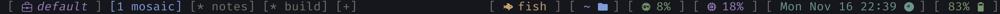

# mosaic.wz [](https://github.com/sravioli/mosaic.wz/releases/latest)

<!-- [](https://github.com/michaelbrusegard/awesome-wezterm) -->

[](https://github.com/sravioli/mosaic.wz/actions/workflows/tests.yaml)
[](https://github.com/sravioli/mosaic.wz/actions/workflows/lint.yaml)
[](https://coveralls.io/github/sravioli/mosaic.wz)
[](../LICENSE)
[](../LICENSE-DOCS)

A status bar engine for [WezTerm](https://wezterm.org/).

You build the bar from modules, and mosaic fits them into the columns the tab
bar leaves free. Modules shrink to shorter variants, drop to icon-only,
truncate, or hide, instead of overflowing. Pick one of eight presets for a
working bar in two lines, or write your own modules: static tables or
functions called on every repaint, with conditions, styles, separators,
fitting strategies and per-module refresh caching, much like heirline.nvim
components.

[Quick start](#quick-start) · [Presets](#pick-a-preset) · [Documentation](#documentation) · [License](#license)

## Quick start

### Requirements

You need WezTerm [`20230320-124340-559cb7b0`](https://wezterm.org/config/lua/wezterm.plugin/require.html)
or newer and a [Nerd Font](https://www.nerdfonts.com/) (or WezTerm's
bundled Nerd Font Symbols fallback) for the presets' and modules' glyphs.

mosaic loads its plugin dependencies itself with `wezterm.plugin.require`;
local API modules on `package.path` take precedence over the remote ones.

| Plugin                                             | Used for                                        | Loaded                  |
| -------------------------------------------------- | ----------------------------------------------- | ----------------------- |
| [warp.wz](https://github.com/sravioli/warp.wz)     | Strings, widths, paths, tables, child processes | Always                  |
| [log.wz](https://github.com/sravioli/log.wz)       | Logging                                         | Always                  |
| [warden.wz](https://github.com/sravioli/warden.wz) | Option validation                               | Always                  |
| [ribbon.wz](https://github.com/sravioli/ribbon.wz) | Building formatted cells                        | Always                  |
| [sigil.wz](https://github.com/sravioli/sigil.wz)   | Icons of the built-in modules and presets       | When a layout names one |

Some built-in modules read the system. Each program runs only while its
module is in a layout, and never from the drawing itself:

| Program                                                                         | Module                  | Platform     | Notes                                                                                             |
| ------------------------------------------------------------------------------- | ----------------------- | ------------ | ------------------------------------------------------------------------------------------------- |
| `/proc` (no program)                                                            | `cpu`, `ram`, `network` | Linux        | Read directly.                                                                                    |
| `df`                                                                            | `disk`                  | Linux, macOS | Every 30 s.                                                                                       |
| `ps`, `vm_stat`, `sysctl`, `netstat`                                            | `cpu`, `ram`, `network` | macOS        | Fast commands only.                                                                               |
| [`playerctl`](https://github.com/altdesktop/playerctl), else systemd's `busctl` | `media`                 | Linux        | Either reads the players' MPRIS interface; with neither, `media` logs a warning and stays hidden. |
| `osascript`                                                                     | `media`                 | macOS        | Ships with macOS.                                                                                 |

`git` and `kube` run no program: they read `.git/HEAD` and the kubeconfig
file. On Windows the system modules and `media` hide themselves.

### Install and run

Put this in `wezterm.lua`:

```lua
local wezterm = require "wezterm"
local mosaic = wezterm.plugin.require "https://github.com/sravioli/mosaic.wz"
local config = wezterm.config_builder()

mosaic.setup { preset = "powerline" }
mosaic.apply_to_config(config)

return config
```

`apply_to_config` registers the `update-status` and `format-tab-title`
handlers, sets `tab_bar_at_bottom` from `position`, and draws the new-tab
button in the preset's style. In an existing config, keep its builder and
return; add the import, setup and `apply_to_config`. Open a window: the
workspace sits on the left, and directory, host, clock and battery on the
right.

## Pick a preset

Set `preset` to one of these names. The screenshots show Kanagawa Wave (dark) and
Kanagawa Lotus (light), in Fira Code Nerd Font.

### `powerline`

Coloured pills on the left, a powerline gradient on the right, slanted numbered tabs.

<picture>
  <source media="(prefers-color-scheme: light)" srcset="assets/presets/light/powerline.png">
  
</picture>

### `minimal`

Accent-coloured text on the bar background, no separators; plain numbered tabs.

<picture>
  <source media="(prefers-color-scheme: light)" srcset="assets/presets/light/minimal.png">
  
</picture>

### `bubbles`

Every module and tab is a rounded pill.

<picture>
  <source media="(prefers-color-scheme: light)" srcset="assets/presets/light/bubbles.png">
  
</picture>

### `slanted`

Every module and tab is a block with slanted edges (`/ … /`); the outermost modules stay flat against the window.

<picture>
  <source media="(prefers-color-scheme: light)" srcset="assets/presets/light/slanted.png">
  
</picture>

### `slanted-inverted`

`slanted`, leaning the other way (`\ … \`).

<picture>
  <source media="(prefers-color-scheme: light)" srcset="assets/presets/light/slanted-inverted.png">
  
</picture>

### `blocks`

Flat blocks one column apart, with no separator glyphs.

<picture>
  <source media="(prefers-color-scheme: light)" srcset="assets/presets/light/blocks.png">
  
</picture>

### `brackets`

Accent-coloured text in dim `[ ]` on the bar background, with ASCII separators.

<picture>
  <source media="(prefers-color-scheme: light)" srcset="assets/presets/light/brackets.png">
  
</picture>

### `pure`

Dim text with each icon in its accent colour, no backgrounds or separator glyphs, as in the pure prompt.

<picture>
  <source media="(prefers-color-scheme: light)" srcset="assets/presets/light/pure.png">
  
</picture>

Each preset supplies a layout, styles every module and tab, and draws the
new-tab button to match. Presets are built only from the public API, so any
of them can be reproduced, or forked, in your own config.

## Documentation

- [Usage](../docs/usage.md): customize without code, write modules, centre
  modules, per-window layouts, notices, editor support.
- [Tabs](../docs/tabs.md): format, compose, rules and badges.
- [Modules](../docs/modules.md): module fields and the built-in modules.
- [Integrations](../docs/integrations.md): modules shipped by other plugins,
  and how to write one.
- [Troubleshooting](../docs/troubleshooting.md)
- [Contributing](contributing.md): local checkout, checks, screenshots.

> [!NOTE]
> The full references are [`docs/configuration.md`](../docs/configuration.md)
> (every option) and [`docs/api.md`](../docs/api.md) (every function, generated
> from the LuaLS annotations).

## License

Code: [GNU GPL v2](../LICENSE). Documentation:
[CC BY-NC 4.0](../LICENSE-DOCS). Preserve existing attribution.
